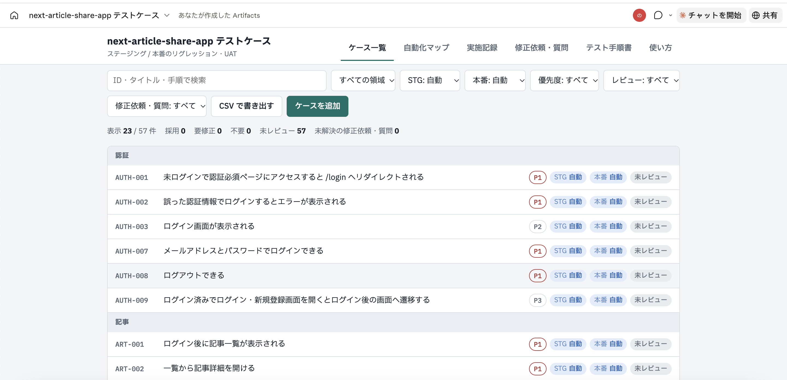

# Web アプリ [next-article-share-app]のテストケース台帳

Web アプリ [next-article-share-app](https://github.com/Hashimoto-Noriaki/next-article-share-app) を対象に、**テスト戦略・テストケース設計・自動化**と、**リグレッションテスト・UAT を運用する仕組み**を、外部 QA の立場で組み立てているリポジトリです。アプリのコードには依存せず、URL と画面だけを前提にテストしています。

> ## 👉 [リグレッションテストケース台帳を開く](https://claude.ai/artifact/MgNuPUxHXpuNYDJKb2Zy83)
>
> next-article-share-app のリグレッションテスト・UAT のテストケースを、チーム（QA・エンジニア・PdM・PM）で管理する台帳です。

ケースごとに、優先度（P1〜P3）とステージング / 本番それぞれの実施方法（自動・手動・対象外）を決めている。画像は「ステージング・本番とも自動」で絞り込んだ 23 / 57 件。ケースは AI でたたき台を作り、チームでレビューして採否を決める（撮影時点ではレビュー中）。

| 画面 | できること |
| --- | --- |
| ケース一覧 | 57 件のケースを領域・環境・自動 / 手動・優先度で絞り込む。ケースごとにレビュー（採用 / 要修正 / 不要） |
| 自動化マップ | 領域ごとに、ステージング / 本番それぞれの自動・手動・対象外の割合と、自動テストの実装状況を見る |
| 修正依頼・質問 | ケースへの修正依頼や仕様の質問をやり取りし、解決まで追う |
| テスト手順書 | 環境と領域を選ぶと、準備 → 各ケースの手順・期待結果 → 後片付けの手順書をケースから自動で組み立てる |
| 実施記録 | リリースごとにリグレッションテスト（優先度で対象を選ぶ）・UAT（変更した領域で選ぶ）を作り、OK / NG / 保留を記録する |

最新の内容は台帳を見る（閲覧には claude.ai へのサインインが必要）。運用ルールは [`test-cases/next-article-share-app/README.md`](test-cases/next-article-share-app/README.md)。

## このリポジトリで示していること

### 1. 環境ごとのテスト戦略（どこを自動化し、どこを人が見るか）

ステージングと本番で、テストケースごとに「自動 / 手動 / 対象外」を決めています。

| | ステージング | 本番 |
| --- | --- | --- |
| 自動 | 原則すべて（UI からデータを作り、後片付けまで自動） | 読み取りだけ（表示・ログイン・アクセス制御） |
| 手動 | OAuth、パスワードリセット（実メール）、画像アップロード、見た目の確認 | 書き込みが必要なもの、OAuth、パスワードリセット |
| 対象外 | - | 入力チェック系（ステージングで担保） |

### 2. リスクにもとづく判断

- **本番では書き込みを自動化しない**: テスト記事が一般ユーザーに見える、実在するユーザーに通知が届く、テストが途中で落ちるとデータが残る、といった影響を避けるため
- **入力チェックのテストを本番で流さない**: 一見安全なテストでも、チェックが壊れていた場合は本番にデータが作られてしまうため
- **優先度を 3 段階で定義**: P1 = 壊れたらリリースできない / P2 = 主要機能 / P3 = その他。リグレッションテストの手動ケースは P1・P2 を対象にする
- **手動にしたケースには理由を残す**: 「外部の認証画面が不安定」「実メールの受信が必要」など。条件がそろえば自動化できるものは、その条件も書く

### 3. テストケースの設計とチームでの運用

- 各ケースに ID・前提条件・手順・期待結果・優先度・環境ごとの自動 / 手動を持たせる
- QA・エンジニア・PdM・PM がレビュー（採用 / 要修正 / 不要）し、修正依頼や質問をケース単位でやり取りする
- リグレッションテストは優先度で、UAT は変更した領域で対象を絞り、リリースごとに結果（OK / NG / 保留）を記録する
- テスト手順書は、ケースの内容から自動で組み立てる（ケースを直せば手順書も最新になる）
- 自動テストの名前は `[ケースID] タイトル` にそろえ、テストケースとコードを対応づける
- たたき台は AI で作り、観点・優先度・採否は人がレビューして決める

### 4. 環境をまたいで使える外部 E2E テスト（Playwright）

- アプリへの依存は URL・画面の文言・`data-testid` のみ。同じテストをローカル → ステージング → 本番で使う
- 作るデータには `e2e-` を付け、テストの後で必ず削除する
- 本番で流すのは書き込みをしない `@smoke` タグのテストだけ

### 5. テスト以外で見つけた品質課題の提起

- ステージング環境が誰でもアクセスできる状態（検索エンジンへの登録、第三者の利用）になっていることに気づき、対応案をつけて Issue を起票した（[next-article-share-app#526](https://github.com/Hashimoto-Noriaki/next-article-share-app/issues/526)）

### 6. セキュリティテストへの取り組み（計画段階）

- API への攻撃を自動で行うツールと、LLM の入出力を評価するツールについて、QA に取り込めるかを評価する計画を立てた（[`poc/docs/`](poc/docs)）
- 対象は自分で用意したローカルの練習用アプリに限定し、既知の脆弱性リストを正解にして検出率と誤検知を採点する

## 進捗（2026-11-19 時点）

| 項目 | 状態 |
| --- | --- |
| テスト戦略・自動 / 手動の判断基準 | ✅ 決定 |
| リグレッションテストケース | 57 件（レビュー中） |
| 自動テスト | 5 件実装済（うちケース ID 対応済み 3 件。自動化の対象は 49 件） |
| リグレッションテストの実施 | ⬜ 未実施（ステージングで初回実施予定） |
| 本番 | 未リリース（リリース後は読み取り系の `@smoke` を流す前提で設計済み） |
| GitHub Actions でのデプロイ後の自動実行 | ⬜ 未着手 |
| セキュリティツールの評価 | 計画済・実行は未着手 |

## 使っているもの

Playwright（TypeScript） / claude.ai Artifact（テストケース台帳） / Claude Code（たたき台の作成・実装の補助）

## 構成

| ディレクトリ | 内容 |
| --- | --- |
| [`common/playwright-next-article-share-app`](common/playwright-next-article-share-app) | next-article-share-app の外部 E2E（Playwright） |
| [`common/playwright-ec2`](common/playwright-ec2) | デモ EC サイト（tutorialsninja）の E2E |
| [`test-cases/`](test-cases) | アプリごとのリグレッションテストケースの運用ルールと画面イメージ |
| [`poc/`](poc) | 外部 E2E の計画書と、セキュリティ系ツールの評価計画 |
