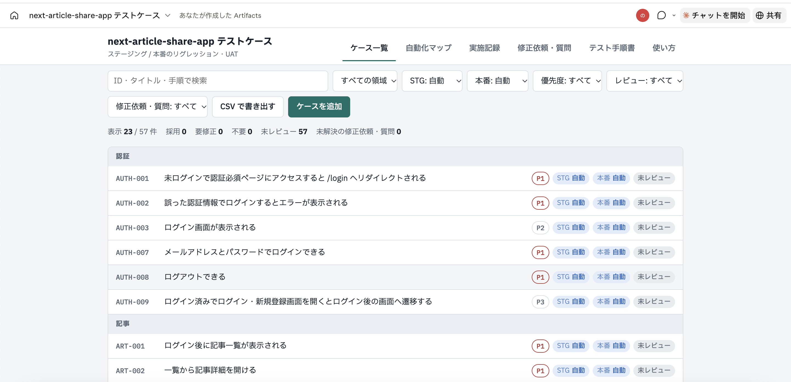

# next-article-share-app リグレッションテストケース

[next-article-share-app](https://github.com/Hashimoto-Noriaki/next-article-share-app) のリグレッションテスト・UAT のテストケース一覧。
QA・エンジニア・PdM・PM が書く前提。

- **正本はテストケース台帳（claude.ai の Artifact）**: https://claude.ai/artifact/MgNuPUxHXpuNYDJKb2Zy83
  - ケースの追加・編集、レビュー（採用 / 要修正 / 不要）、リグレッション・UAT の実施記録はここで行う

| 自動化マップ | ケース一覧 |
| --- | --- |
|  |  |

画像は撮影時点のもの。件数や中身の最新は台帳を見る。

関連:

- 自動テストの実装: [`common/playwright-next-article-share-app`](../../common/playwright-next-article-share-app)
- 外部 E2E の方針: [`poc/next-article-share-app/poc-plan.md`](../../poc/next-article-share-app/poc-plan.md)

## 列の意味

| 列 | 内容 |
| --- | --- |
| `id` | `領域プレフィックス-連番`（例: `ART-003`）。一度振った ID は変えない・使い回さない |
| `area` | 領域（認証・記事・下書き・コメント・いいね・ストック・通知・ユーザー・静的ページ・横断） |
| `title` | テストケース名。「〜できる」「〜が表示される」など結果が分かる形で書く |
| `precondition` | 前提条件（ログイン状態・必要なデータ）。本番で固定データが必要なときは「本番は〜」と書く |
| `steps` | 手順（番号付き） |
| `expected` | 期待結果 |
| `priority` | `P1`: 壊れたらリリースできない / `P2`: 主要機能 / `P3`: その他 |
| `stg` | ステージングでの実施方法（下記） |
| `prod` | 本番での実施方法（下記） |
| `reason` | 手動・対象外にした理由、注意点 |
| `automation_status` | 自動テストの実装状況（`実装済` / `未実装` / `-`: 自動化しない） |

### `stg` / `prod` の値

| 値 | 意味 |
| --- | --- |
| `auto` | Playwright で自動実行する |
| `manual` | 人が手順に沿って確認する |
| `none` | その環境では実施しない（理由を `reason` に書く） |

## 自動・手動の判断基準

### ステージング

- 原則すべて自動化する。テストデータは UI から作り、`e2e-` プレフィックスを付けて後片付けする
- 手動にするのは次のものだけ
  - OAuth（GitHub / Google）: 外部プロバイダの画面・2 段階認証があり不安定
  - パスワードリセット: 実メールの受信が必要
  - 画像アップロード: Cloudinary に実ファイルが送られる
  - 見た目の良し悪し（表示崩れ・スマホ表示）

### 本番

- **書き込みは自動化しない**。自動化するのは読み取りだけ（`@smoke` タグ）
  - 一般ユーザーに見える、他ユーザーに通知が届く、テストが落ちるとデータが残る、などの影響があるため
- 書き込みが必要なケースは `manual`（UAT で固定テストアカウントを使い、その場で削除する）
- 入力チェック系（エラーで弾かれるはずのもの）も本番では流さない。チェックが壊れていると本番にデータが作られるため。ステージングで担保する
- 本番の自動テストには次の固定データが必要
  - 固定テストアカウント（認証情報は Secrets で渡す）
  - 固定テストアカウントの公開記事 1 件（コメント付き）
  - 他ユーザーの公開記事 1 件

## 自動テストとの対応

Playwright のテスト名は `[ID] title` にする。`prod` が `auto` のケースには `{ tag: '@smoke' }` を付ける。

```ts
test('[AUTH-002] 誤った認証情報でログインするとエラーが表示される', { tag: '@smoke' }, async ({ page }) => {
  // ...
});
```

```bash
npx playwright test -g "ART-003"   # ID で 1 件だけ実行
```

自動テストを実装したら `automation_status` を `実装済` にする。

## 運用

| 種類 | タイミング | 対象 |
| --- | --- | --- |
| リグレッション | リリース前（ステージング）、リリース後（本番） | 自動ケースは CI ですべて実行。手動ケースは P1・P2 を実施 |
| UAT | リリースごと | 変更した領域（`area`）の手動ケースと、変更内容に合わせて追加したケース |

## ケースの追加・変更

1. 台帳の「ケースを追加」から登録する（ID は領域内の連番の続きが自動で入る）
2. ステージング / 本番を上の判断基準で決め、手動・対象外にしたら理由を書く
3. 不要になったケースは消さず、レビューを「不要」にするか、タイトルの先頭に `【廃止】` を付ける（ID を使い回さないため）
